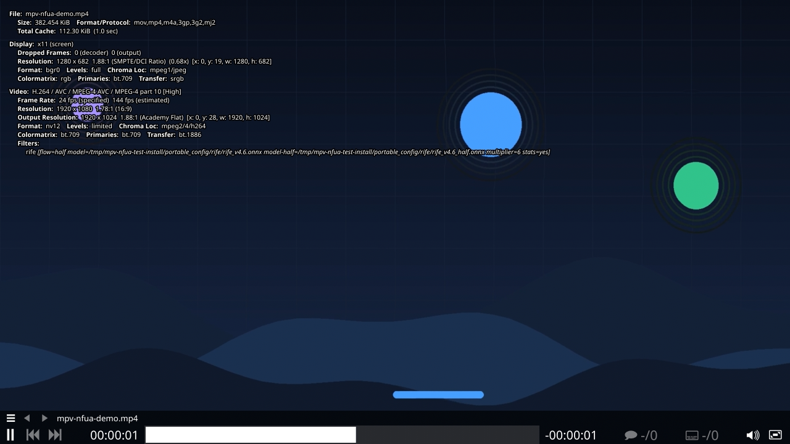
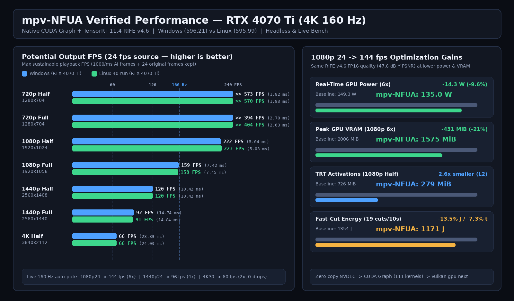
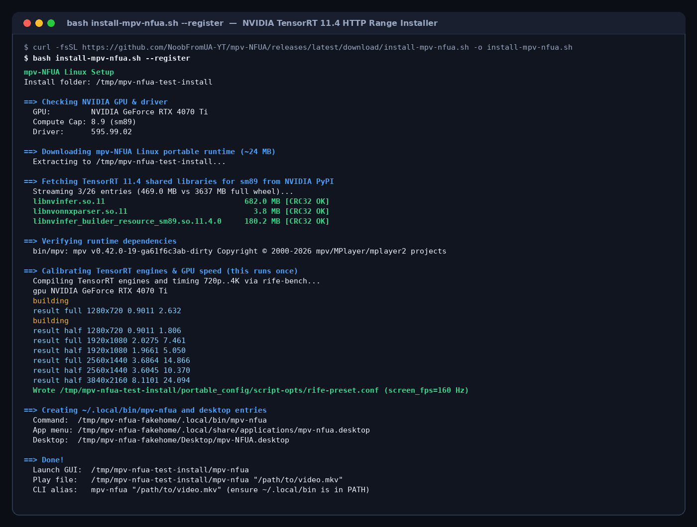

# mpv-NFUA

[](https://github.com/NoobFromUA-YT/mpv-NFUA/releases/latest)
[](#installation)
[](#requirements)
[](LICENSE)

**Zero-copy CUDA Graph + TensorRT 11.4 RIFE v4.6 AI frame interpolation built directly into `mpv 0.42` — for Windows & Linux.**

No VapourSynth, no Python frame server, no CPU texture copies: NVDEC hardware-decoded frames stay in CUDA device memory through color conversion, high-priority scene-cut detection, TensorRT FP16 inference (captured into a single CUDA graph per frame), and Vulkan `gpu-next` zero-copy presentation.

- **Project Page:** https://noobfromua-yt.github.io/mpv-NFUA/
- **Latest Release:** https://github.com/NoobFromUA-YT/mpv-NFUA/releases/latest
- **1-Click Windows Installer (~23 KB):** [`Install-MPV-NFUA.bat`](https://github.com/NoobFromUA-YT/mpv-NFUA/releases/latest/download/Install-MPV-NFUA.bat)
- **1-Click Linux Installer (~24 KB):** [`install-mpv-nfua.sh`](https://github.com/NoobFromUA-YT/mpv-NFUA/releases/latest/download/install-mpv-nfua.sh)

---

## Preview & Benchmarks

| Real-Time `mpv-NFUA` 1080p 24 → 144 fps (`stats` overlay) | Verified RTX 4070 Ti Performance & Efficiency |
| :---: | :---: |
|  |  |

<details>
<summary>Linux 1-Click Smart Installer output (HTTP Range TensorRT 11.4 fetch + auto-calibration)</summary>



</details>

---

## Requirements

- **GPU:** NVIDIA RTX 20 series or newer (Turing / Ampere / Ada / Blackwell, `sm75+`)
- **Driver:** Current NVIDIA driver with CUDA 13 support (e.g. `595.99` on Linux / `596.21` on Windows tested)

---

## Installation

### Windows 10 / 11 (1-Click Web Installer — Recommended)

1. Download **[Install-MPV-NFUA.bat](https://github.com/NoobFromUA-YT/mpv-NFUA/releases/latest/download/Install-MPV-NFUA.bat)** (~23 KB).
2. Double-click it and pick an install folder (defaults to `%LOCALAPPDATA%\MPV-NFUA`).
3. The installer automatically:
   - Downloads the slim portable `mpv-NFUA` runtime (**85 MB** `MPV-NFUA-Windows-Portable.zip`).
   - Queries your GPU architecture via `nvidia-smi` and streams **only the 3 TensorRT 11.4 DLLs your GPU needs** directly from `pypi.nvidia.com` via HTTP Range requests (**~349 MB** download instead of the 1.86 GB multi-arch wheel, CRC32-verified, saving ~1.6 GB on disk).
   - Compiles both Windows TensorRT engines (`full` and `half` flow), measures your GPU and monitor refresh rate, and writes `portable_config/script-opts/rife-preset.conf`.
   - Optionally creates a Desktop shortcut and sets `mpv-NFUA` as your default `mpv`.

Total size after setup: **~782 MB** on disk (vs. 2.40 GB with all TensorRT architectures bundled).

Prefer manual download? Grab **[MPV-NFUA-Windows-Portable.zip](https://github.com/NoobFromUA-YT/mpv-NFUA/releases/latest/download/MPV-NFUA-Windows-Portable.zip)** (85 MB) from Releases, extract, and run `Setup-MPV-Antigravity.bat`.

---

### Linux `x86_64` (1-Click Smart Installer — Recommended)

Prebuilt `bin/mpv` targets **Ubuntu 26.04+ / modern rolling distros** (`glibc 2.43`, FFmpeg 8, `libplacebo 360`). Older distros can pass `--build` or compile directly from `source/`.

```bash
curl -fsSL https://github.com/NoobFromUA-YT/mpv-NFUA/releases/latest/download/install-mpv-nfua.sh -o install-mpv-nfua.sh
bash install-mpv-nfua.sh
```

What `install-mpv-nfua.sh` does:
- Downloads the slim portable runtime (**22 MB** `MPV-NFUA-Linux-x86_64.tar.gz`) into `~/.local/share/mpv-nfua` (or `--dir <path>`).
- Queries `nvidia-smi` and streams **only the 3 TensorRT 11.4 `.so` libraries your GPU needs** from `pypi.nvidia.com` via HTTP Range requests (**469 MB** instead of the **3.64 GB** multi-arch wheel, CRC32-verified, ~923 MB total on disk).
- Runs `rife-bench` to compile both `dyn2p-hwc8` TensorRT engines and calibrate `portable_config/script-opts/rife-preset.conf` to your monitor's refresh rate (`xrandr` / `wlr-randr` / `kscreen-doctor`).
- Optionally creates `~/.local/bin/mpv-nfua` and `.desktop` shortcuts (`--register`, without overwriting `/usr/bin/mpv` or your default associations).

Useful flags: `--dir <path>`, `--register`, `--no-prompt`, `--skip-bench`, `--build` (builds `mpv` & `rife-bench` from `source/` on distros with different FFmpeg/`libplacebo`/`glibc` versions).

<details>
<summary>Manual Linux tarball or Build from source/</summary>

**Manual portable tarball:** Download **[MPV-NFUA-Linux-x86_64.tar.gz](https://github.com/NoobFromUA-YT/mpv-NFUA/releases/latest/download/MPV-NFUA-Linux-x86_64.tar.gz)** (22 MB), extract it, and run `./install-mpv-nfua.sh` inside the extracted folder to pull only your GPU's TensorRT `.so` libs and calibrate.

**Build from `source/`** (exact same `vf_rife` C++/CUDA/TensorRT codebase as Windows):
1. Clone upstream mpv (`0.42`, commit `a61f6c3abd`), apply `source/mpv-changes.patch`, and copy `source/video/filter/*` into `video/filter/`.
2. Install dependencies (`ffmpeg`, `libplacebo >= 7.387.0`, `luajit`, `shaderc`, `vulkan-loader`, CUDA Toolkit `nvcc`, TensorRT 11.4 headers/libs) and run [`source/build.sh`](source/build.sh) (uses `-Wl,--disable-new-dtags,-rpath,$ORIGIN/../lib` so TensorRT's `dlopen()` of `libnvinfer_builder_resource_<sm>.so.11.4.0` finds `../lib/`).
3. Copy `source/portable_config/` next to the binary and place `rife_v4.6.onnx` + `rife_v4.6_half.onnx` in `portable_config/rife/`.

</details>

---

## Verified Benchmarks (RTX 4070 Ti, 3840x2160 @ 160 Hz)

Measured via `rife-bench` (40 runs on Linux driver `595.99`, 20 runs on Windows driver `596.21`; **Max Output FPS** from a `24 fps` source = `1000/ms + 24`):

| Resolution | Flow Mode | Max Output FPS (24 fps src) | Windows (`ms`) | Linux (`ms`) | Auto Multiplier (160 Hz) |
| :--- | :--- | :--- | :--- | :--- | :--- |
| **720p** (`1280x720`) | Full | **`~404 FPS`** | `2.70 ms` | `2.63 ms` | `24->6x`, `30->5x`, `60->2x` |
| **720p** (`1280x720`) | Half | **`~570 FPS`** | `1.82 ms` | `1.83 ms` | (used on high fps) |
| **1080p** (`1920x1080`) | Full | **`~158 FPS`** | `7.42 ms` | `7.45 ms` | — |
| **1080p** (`1920x1080`) | Half | **`~223 FPS`** | `5.04 ms` | `5.03 ms` | `24->6x`, `30->5x`, `60->2x` |
| **1440p** (`2560x1440`) | Full | **`~91 FPS`** | `14.74 ms` | `14.84 ms` | — |
| **1440p** (`2560x1440`) | Half | **`~120 FPS`** | `10.42 ms` | `10.42 ms` | `24->4x`, `30->3x`, `60->2x` |
| **4K** (`3840x2160`) | Half | **`~66 FPS`** (`30->60 live`) | `23.89 ms` | `24.03 ms` | `24->2x`, `30->2x` (`50/60`: off) |

### Efficiency & Scene-Cut Comparison (Linux, RTX 4070 Ti, 1080p 24 → 144 fps `6x` half flow)

Measured with `nvidia-smi` at 150 ms polling intervals (`vo=null`, same RIFE v4.6 FP16 weights — `47.59 dB` luma PSNR parity):

| Workload | Baseline (`dyn128-4096`) | `mpv-NFUA` (`dyn2p-hwc8`) | Gain |
| :--- | :--- | :--- | :--- |
| **Real-time 10s smooth (144 fps)** | `149.3 W` avg / `2006 MiB` peak VRAM / `726 MiB` act | **`135.0 W` avg / `1575 MiB` peak VRAM / `279 MiB` act** | **-14.3 W (-9.6%), -431 MiB VRAM, 2.6x smaller activations** |
| **Uncapped 10s smooth (`--untimed`)** | `201.1 W` avg / `6.77 s` wall | **`183.4 W` avg / `6.73 s` wall** | **-17.7 W (-8.8%)** |
| **Uncapped 10s fast cuts (19 cuts)** | `1195` TRT frames / `6.75 s` / `1354 J` | **`1110` TRT frames / `6.26 s` / `1171 J`** | **-85 skipped cuts, -7.3% wall time, -13.5% GPU energy** |

Live Windows playback (`vo=gpu-next`, `gpu-api=vulkan`, `hwdec=nvdec`): **0 dropped frames** across `1080p24` (`6x` = 144 fps, `6.74 ms` GPU), `4K24` (`2x` = 48 fps, `26.3–27.3 ms` GPU), and `4K30` (`2x` = 60 fps, `25.76 ms` GPU).

---

## Hotkeys

| Key | Action |
| :--- | :--- |
| `Alt+0` | Automatic multiplier & flow mode (`rife.lua`) |
| `Alt+1` | Turn RIFE off (original fps) |
| `Alt+2` .. `Alt+6` | Fixed `2x` .. `6x` multiplier |
| `Alt+7` | Cycle HDR tone-mapping look (`look.lua`) |
| `Alt+8` | Cycle height alignment trim mode (`always` / `nearest` / `no`) |
| `Alt+9` | Re-run GPU & refresh rate benchmark (`rife-bench`) |
| `+` / `=` / `-` | Step playback speed in `1x` increments (`speedstep.lua`, auto-rescales RIFE) |
| `MBTN_BACK` / `MBTN_FORWARD` | Toggle fullscreen / seek `+10s` |
| `o` / `щ` | Quit player |
| `i` | mpv stats overlay (fps, dropped frames) |

---

## Architecture Highlights

- **Single CUDA graph per frame:** `rife_pre` (vectorized NV12/P010/P012/P016 → fp16 RGB + 3-tap co-sited chroma AA) + TensorRT 11.4 inference + `rife_post` (fp16 RGB → NV12/P010/P012/P016) captured into one `CUgraphExec` (`kHWC8`/`kLINEAR` auto-selected per profile).
- **2-profile dynamic engine (`dyn2p-hwc8`) + persistent timing cache:** Profile 0 tuned for `<=1440p` (`279 MiB` activations at 1080p half, fitting inside Ada L2 cache) and Profile 1 tuned for `4K`, avoiding the memory bandwidth and wattage cost of a single oversized profile.
- **Dedicated high-priority scene-cut detection:** `rife_scd_cells` + `rife_scd_reduce` (warp-shuffle reduction) run once per frame pair on a high-priority stream; scene cuts skip TensorRT inference completely.
- **Pair-level tensor reuse (`timestep_only`):** Multi-frame pairs (`3x`–`6x`) skip re-converting `f0`/`f1` after the first interpolated frame and update only the timestep channel.
- **Graph slicing:** Heavy frames (`4K`) are automatically split into short GPU slices with 1 ms gaps (`slice=6:slice-gap=1`) on a background worker thread so display presentation stays smooth.
- **MSVC / MinGW ABI bridge (`trt_shim.cpp`):** Compiled freestanding with `clang++ --target=x86_64-pc-windows-msvc -nostdinc++` so MinGW-built `mpv.exe` calls directly into MSVC-built `nvinfer_11.dll` / `nvonnxparser_11.dll`.
